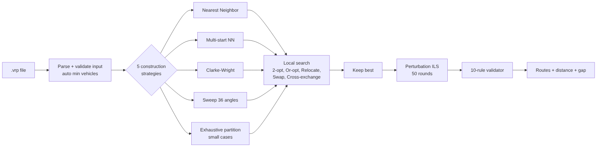
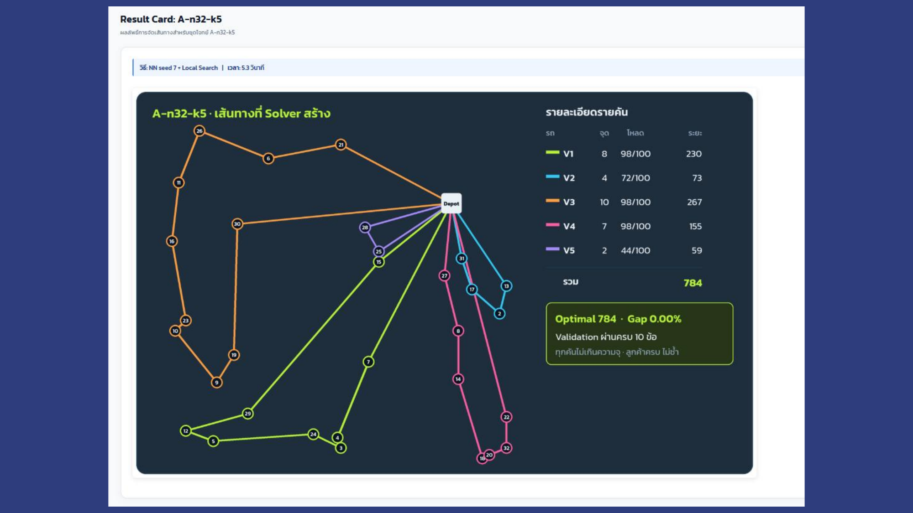
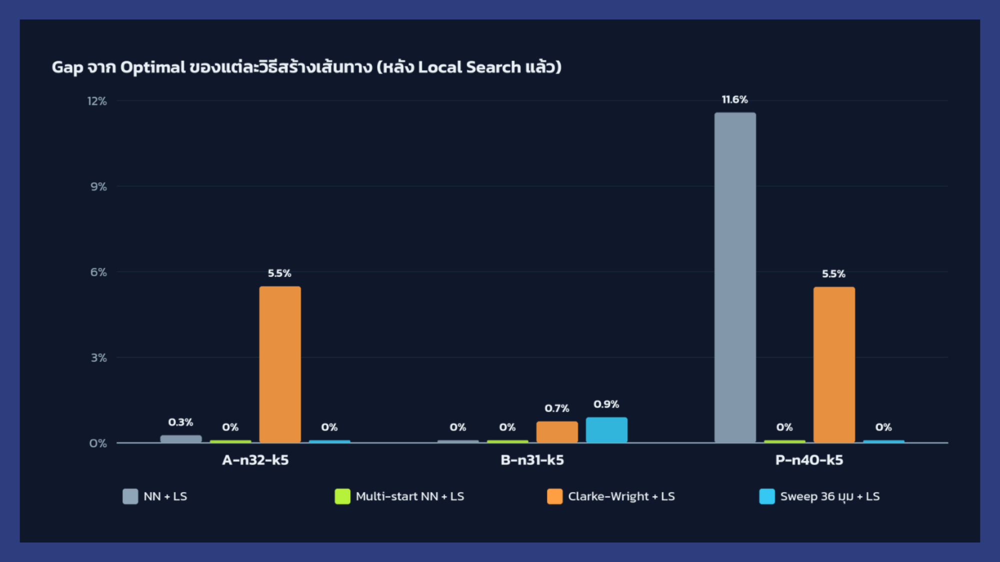
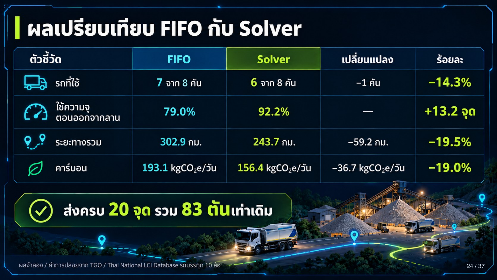
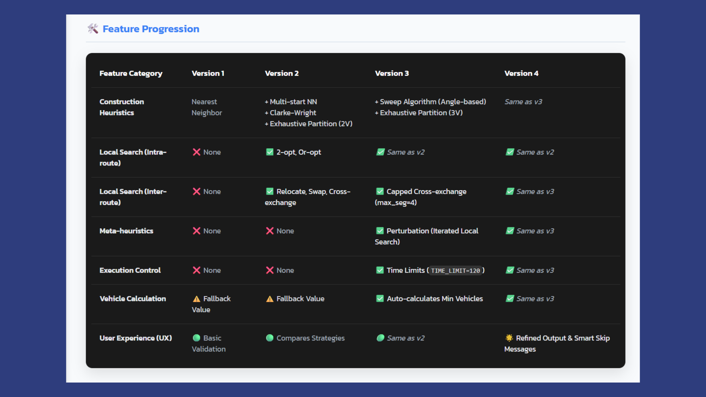

# Multi-Strategy CVRP Solver

**A Python solver for the Capacitated Vehicle Routing Problem that reaches the optimal solution on all 3 benchmark instances (0.00% gap), applied to a real-world SCG CPAC aggregate-delivery case to cut distance by 19.5% and CO₂ by 19.0%.**

Qualifier-round submission for *AI Hackathon Route Optimization 2026* (264 teams → finalist, top 30).

## Table of contents
- [Overview](#overview)
- [Key Features](#key-features)
- [Results](#results)
  - [Benchmarks](#benchmarks)
  - [Self-created case: CPAC aggregate delivery](#self-created-case-cpac-aggregate-delivery)
- [Tools / Technologies](#tools--technologies)
- [Development environment](#development-environment)
- [How things work](#how-things-work)
- [How to setup](#how-to-setup)
  - [Run locally](#run-locally)
  - [Run on Google Colab](#run-on-google-colab)
  - [Use your own instance](#use-your-own-instance)
- [Repository structure](#repository-structure)
- [References / Useful resources](#references--useful-resources)
- [My notes](#my-notes)

## Overview
The CVRP asks: given a depot, customers with demands, and trucks with a fixed capacity, which customers should each truck visit, and in what order, so that total distance is as short as possible? Trying every option is impossible even for 30 customers (30! ≈ 2.65 × 10³²), so this solver combines several fast heuristics, improves each with local search, and keeps the best answer. Every answer is re-checked by an independent validator before it is reported.

Demo on YouTube (Thai): https://youtu.be/gQj0TL_FaPQ

[](https://youtu.be/gQj0TL_FaPQ)

Submitted slides: [docs/qualifier_slides.pdf](docs/qualifier_slides.pdf) (Thai)



## Key Features
- **5 construction strategies:** Nearest Neighbor, Multi-start NN (from every customer), Clarke-Wright Savings, Sweep (36 start angles) and exhaustive partition for very small instances. No single method wins on every instance, so the solver runs them all.
- **6 local-search moves:** 2-opt and Or-opt inside a route; Relocate, Swap and Cross-exchange between routes.
- **Perturbation (Iterated Local Search):** 50 random kicks (reverse segment, move customer, swap between routes) to escape local optima.
- **Feasibility first:** a move that breaks truck capacity is rejected before its distance is compared.
- **Independent 10-rule validator:** nodes exist, every customer served exactly once, capacity, load match, vehicle count, start/end at depot, no depot mid-route, distances recomputed.
- **Automatic vehicle count:** read from the file, or computed as ⌈total demand / capacity⌉ when missing.
- **Safe on large inputs:** 120-second time limit; cross-exchange segment length capped at 4.
- **Reproducible:** fixed random seed (`random.seed(42)`).

## Results

### Benchmarks

| Instance | Customers | Vehicles | Capacity | **Solver** | Best known | Gap | Best strategy | Time |
|---|---|---|---|---|---|---|---|---|
| A-n32-k5 | 31 | 5 | 100 | **784** | 784 | **0.00%** | Multi-start NN (seed 7) + LS | 6–14 s |
| B-n31-k5 | 30 | 5 | 100 | **672** | 672 | **0.00%** | NN + LS | 6–9 s |
| P-n40-k5 | 39 | 5 | 140 | **458** | 458 | **0.00%** | Multi-start NN (seed 6) + LS | 13 s |



Why run several strategies? On P-n40-k5, single-start Nearest Neighbor + local search stops at 511 (11.6% gap), while Multi-start NN and Sweep reach the optimum 458.



### Self-created case: CPAC aggregate delivery
`CPAC-AGG-LKB-20`: a depot in Lat Krabang delivers sand and stone with 10-wheel dump trucks (15 t usable capacity, 8 available) to 20 construction sites, 83 t in total. Latitude/longitude were converted to kilometres for the solver.

| Metric | FIFO (current practice) | **Solver** | Change |
|---|---|---|---|
| Trucks used | 7 of 8 | **6 of 8** | −1 truck (−14.3%) |
| Load factor leaving depot | 79.0% | **92.2%** | +13.2 pts |
| Total distance | 302.9 km | **243.7 km** | −19.5% |
| CO₂ | 193.1 kgCO₂e/day | **156.4 kgCO₂e/day** | −19.0% (≈ 9.54 t CO₂e/year) |

All 20 sites still receive the full 83 t, and 6 trucks is the theoretical minimum (⌈83 / 15⌉ = 6).



## Tools / Technologies
- Language: [Python 3](https://www.python.org/)
- Data handling: [pandas](https://pandas.pydata.org/)
- Standard library: `math`, `random`, `time`, `collections`, `re`, `os`, `sys`
- Notebook / runtime: [Google Colab](https://colab.research.google.com/)
- Benchmark data: [CVRPLIB](http://vrp.galgos.inf.puc-rio.br/index.php/en/) (Augerat sets A, B, P)
- CO₂ factors: TGO / Thai National LCI Database

## Development environment
1. Python 3.9+ (tested on 3.12)
2. pandas
3. VS Code or Google Colab

## How things work
1. **Read the `.vrp` file:** parse coordinates, demands, capacity and depot; read the vehicle limit from the file's COMMENT, or compute the minimum number of trucks.
2. **Build the distance matrix:** Euclidean distance rounded with the TSPLIB `EUC_2D` rule, `floor(d + 0.5)`.
3. **Construct starting routes with 5 strategies:**
   - *Nearest Neighbor* – go to the closest customer that still fits in the truck.
   - *Multi-start NN* – repeat NN starting from every customer, keep the best.
   - *Clarke-Wright Savings* – merge routes in order of the largest distance saved.
   - *Sweep* – sort customers by angle around the depot and cut into trucks; try 36 start angles.
   - *Exhaustive partition* – try every split for very small instances (2–3 trucks).
4. **Improve each solution with local search** until no move helps:
   - inside a route: 2-opt (reverse a segment), Or-opt (move a short chain);
   - between routes: Relocate, Swap, Cross-exchange.
5. **Keep the best solution** across all strategies.
6. **Perturb and re-optimise** 50 times; accept only improvements.
7. **Validate** the final answer with 10 rules, recomputed from the original data.
8. **Report** routes, load per truck, total distance, gap to optimal (when the file has one) and which strategy won.

### Version history



## How to setup

### Run locally
```bash
git clone https://github.com/doypuy-dotcom/cvrp-heuristic-solver.git
cd cvrp-heuristic-solver
pip install -r requirements.txt
python routeoptimization_version4.py benchmarks/A-n32-k5.vrp
```

### Run on Google Colab
1. Open a new notebook and paste the whole of `routeoptimization_version4.py` into one cell.
2. Run the cell, click **Choose Files**, and upload a `.vrp` file.

The submitted notebooks with full output are in [`results/notebooks/`](results/notebooks/).

### Use your own instance
Any CVRPLIB file with `TYPE : CVRP` and `EDGE_WEIGHT_TYPE : EUC_2D` works. See [`self-created-case/CPAC-AGG-LKB-20.vrp`](self-created-case/CPAC-AGG-LKB-20.vrp) for an example built from real-world locations.

## Repository structure
```
routeoptimization_version4.py   solver (v4)
benchmarks/                     A-n32-k5, B-n31-k5, P-n40-k5
self-created-case/              CPAC-AGG-LKB-20.vrp
results/notebooks/              submitted Colab notebooks with full output
results/logs/                   re-run console logs
docs/                           submitted slides and Thai run instructions
images/                         figures used in this README
notes/                          design notes and lessons learned
```

## References / Useful resources
- [CVRPLIB – Capacitated Vehicle Routing Problem Library](http://vrp.galgos.inf.puc-rio.br/index.php/en/)
- Clarke, G. & Wright, J. W. (1964). *Scheduling of Vehicles from a Central Depot to a Number of Delivery Points.* Operations Research.
- Gillett, B. & Miller, L. (1974). *A Heuristic Algorithm for the Vehicle-Dispatch Problem* (Sweep algorithm). Operations Research.
- Croes, G. A. (1958). *A Method for Solving Traveling-Salesman Problems* (2-opt). Operations Research.
- Lourenço, H., Martin, O. & Stützle, T. (2003). *Iterated Local Search.* Handbook of Metaheuristics.

## My notes
Design decisions, what did not work, and lessons learned are in [notes/README.md](notes/README.md).

---
Team project by **Kongphob Onnom** (Robotics & AI Engineering, KMITL) and teammates, developed with AI assistance. Benchmark instances © CVRPLIB / Augerat et al.
